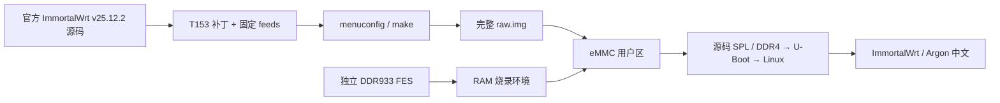

# OmniGate T153 · ImmortalWrt 25.12.2

**四核 Cortex-A7 · 源码 DDR4 / SPL / U-Boot · Argon 中文管理 · 4G 与多 WAN 软件套件**

本分支保存 OmniGate T153 的 ImmortalWrt 25.12.2 板级代码、构建补丁、配置、烧录说明及实测记录。使用官方源码包加补丁，再执行常规 `feeds`、`make menuconfig` 和 `make`，即可生成包含启动区、内核和根文件系统的完整 eMMC 镜像。

[下载正式发布 r1](https://github.com/dshanpi/OmniGateT153-Openwrt25/releases/tag/v25.12.2-t153-immortalwrt-r1) · [烧录与首次访问](docs/FLASH.md) · [从源码构建](docs/BUILD.md) · [发布说明](RELEASE-NOTES.md)

> **r1 已完成实机烧录、重启、四核在线、LAN DHCP 和 Argon 中文登录页访问验证。** 本次启动出现 AIC8800D80 Wi-Fi 上电失败；Wi-Fi 暂不能作为可用功能交付。WAN 千兆稳定性、蓝牙、4G 拨号、多 WAN 切换和长期运行尚未完成本版验收。

## 下载与上手

| 下载 | 用途 |
|---|---|
| [完整 raw.img（292 MiB）](https://github.com/dshanpi/OmniGateT153-Openwrt25/releases/download/v25.12.2-t153-immortalwrt-r1/immortalwrt-sunxi-cortexa7-dshanpi_t153mx-omnigate-ext4-raw.img) | 写入 eMMC，未压缩，可直接选择 |
| [独立 DDR933 FES](https://github.com/dshanpi/OmniGateT153-Openwrt25/releases/download/v25.12.2-t153-immortalwrt-r1/t153-fes-ddr933-ram-loader.img) | 仅在 RAM 中初始化 DRAM 并提供烧录通道 |
| [SHA256SUMS](https://github.com/dshanpi/OmniGateT153-Openwrt25/releases/download/v25.12.2-t153-immortalwrt-r1/SHA256SUMS) | 核对镜像与附件 |

烧录采用 **raw 完整盘 → eMMC 用户区**，与独立 FES 分别选择；启用写入校验和重启。**不要启用额外的“eMMC Boot0 写入 / `--emmc-boot0-from-image`”路径。** 本项目已验证的流程不需要该扩展。完整步骤见 [FLASH.md](docs/FLASH.md)。

启动后，电脑网线直连 **eth0 / LAN**，自动获取地址，访问 [http://192.168.153.1/](http://192.168.153.1/)。**eth1 / WAN** 默认 DHCP，不开放 WAN 管理。首次使用 `root` 登录后设置密码。

## 分支代码布局

本分支是 **T153 适配集成仓库**，不是完整 ImmortalWrt 源码树，不能在克隆本仓库后直接运行 `make`。

```text
port/immortalwrt/       83 份按上游目录展开的适配源码
  manifest.json        源码清单、路径与摘要
  upstream-changes.patch  6 份上游已有文件的修改，供审阅
patches/               应用于官方干净源码的完整板级补丁
configs/               最小配置、源码与 feeds 锁定信息
host-tools/            独立 FES / MCP 工具及历史操作说明
scripts/               既有 FES 打包与维护脚本
tests/                镜像与运行状态检查工具
docs/                 构建、烧录、验收与历史资料
```

`port/immortalwrt/` 用于阅读和维护，不要将整个目录直接复制覆盖官方源码。实际构建使用 `patches/immortalwrt-25.12.2-t153-r1.patch`；完整步骤见 [BUILD.md](docs/BUILD.md)。旧版 OpenWrt 与历史文档仍保留，r1 操作以本分支入口和发布附件为准。

## 插件扩展分支

需要工业网关常用能力时，使用专用分支 [`immortalwrt-25.12-t153-plugins`](https://github.com/dshanpi/OmniGateT153-Openwrt25/tree/immortalwrt-25.12-t153-plugins)。它在 r1 板级补丁上加入网络安全、监控、VPN、串口工业和 USB/存储插件；服务默认关闭，完整清单、构建和烧录方法见 [`docs/PLUGINS.md`](docs/PLUGINS.md)、[`docs/BUILD-PLUGINS.md`](docs/BUILD-PLUGINS.md) 和 [`docs/FLASH-PLUGINS.md`](docs/FLASH-PLUGINS.md)。

## 固定版本

| 项目 | r1 |
|---|---|
| 系统 | ImmortalWrt 25.12.2，`r38135-0c4cd0f9920a` |
| 内核 | Linux 6.12.103 + T153 板级补丁 |
| 硬件 | T153 OmniGate，4× Cortex-A7，1 GiB DDR4，eMMC |
| 当前内存窗口 | Linux / U-Boot 使用 384 MiB |
| 目标 / profile | `sunxi/cortexa7` / `dshanpi_t153mx-omnigate` |
| 持久引导 | 源码 DDR4 初始化、SPL、U-Boot 2026.07 |
| 本次发布 | `v25.12.2-t153-immortalwrt-r1`，2026-11-16 |
| 维护分支 | `immortalwrt-25.12-t153` |

r1 与已实测的 preview.2 **镜像字节完全一致**，本次整理代码与记录并正式发布，没有重新编译或更换未经验证的镜像。raw SHA256：

```text
2a0baa4305fda37071734b81a86ef468915f56b0cd828d3ab44bb18c961da853
```

## 默认软件

- **管理**：LuCI、Argon、主题配置、简体中文。
- **移动网络**：QMI / MBIM / PPP、EC20 / ML302 所需 USB 网卡与串口驱动、3ginfo-lite、sms-tool-js。
- **网络工具**：mwan3、SmartDNS、DDNS、nlbwmon。
- **板级驱动**：T153 四核、以太网、CAN；AIC8800D80 Wi-Fi / 蓝牙驱动及设备固件已编入。

软件预装不等于对应硬件功能已经验收。mwan3 和 SmartDNS 默认不启用；4G 的 APN、USB 模式和 AT 端口按实际模块配置。AIC Wi-Fi 本次启动失败，详见下表。

## 已验证与待完成

| 项目 | 本次结果 |
|---|---|
| 源码归档、补丁、feeds、构建与镜像结构检查 | 通过 |
| FES raw 写入 eMMC 用户区 | 写入 306,184,192 字节，FES 校验和重启通过 |
| 持久启动区独立校验 | 磁盘前 4 MiB 的 SHA256 与发布镜像一致 |
| 源码 DDR4 → U-Boot → Linux → ImmortalWrt | 启动通过，CPU `0-3` 在线 |
| eth0 / LAN | 协商 1 Gbps / 全双工，电脑取得 `192.168.153.169` |
| LuCI | 从电脑取得 Argon 中文登录页；未将取得登录页等同于所有插件操作验收 |
| AIC8800D80 Wi-Fi | **启动日志显示上电失败，未验证可用** |
| eth1 / WAN | 既有千兆重复协商问题尚未确认解决 |
| 蓝牙、EC20 / ML302 数据拨号、mwan3 切换 | 本版未验收 |
| 断电冷启动、多次重启、长期压力与吞吐 | 本版未完成 |

本版不支持 `sysupgrade` 或 LuCI“刷写固件”升级，继续使用 FEL / FES 完整盘流程。CPU_OFF / 热插拔、suspend 和多核 kexec 不在已实现接口范围内。

## 引导与构建关系



持久 DDR4 / SPL / U-Boot 从源码构建；**临时 FES 和无线设备固件含二进制组件**。这是项目维护的 T153 移植，并不表示 T153 已获 ImmortalWrt 官方支持。
