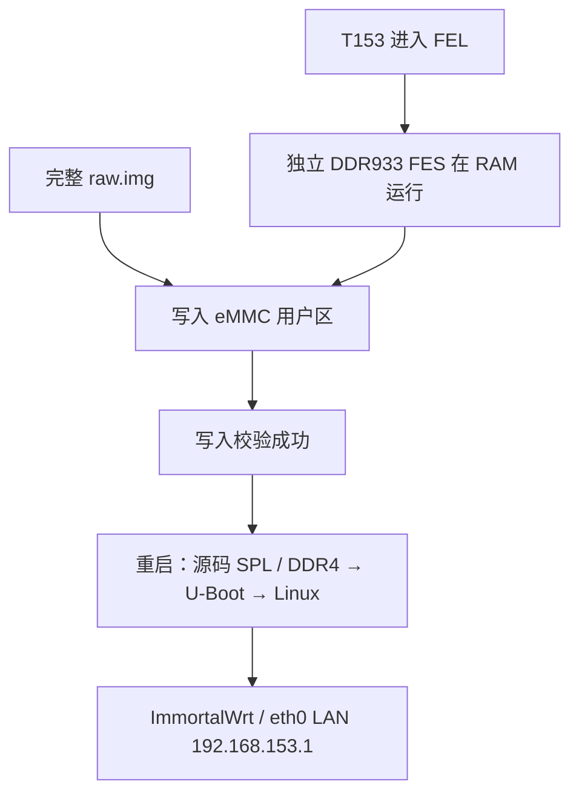

# T153 r1 烧录与首次访问

适用：**OmniGate T153 / 1 GiB DDR4 / eMMC**。本版已用下述 raw 用户区流程完成实机烧录、校验和重启。

## 选这两个文件

| 烧录工具字段 | 文件 |
|---|---|
| 固件 / 完整 raw 镜像 | [`immortalwrt-sunxi-cortexa7-dshanpi_t153mx-omnigate-ext4-raw.img`](https://github.com/dshanpi/OmniGateT153-Openwrt25/releases/download/v25.12.2-t153-immortalwrt-r1/immortalwrt-sunxi-cortexa7-dshanpi_t153mx-omnigate-ext4-raw.img) |
| FES / loader | [`t153-fes-ddr933-ram-loader.img`](https://github.com/dshanpi/OmniGateT153-Openwrt25/releases/download/v25.12.2-t153-immortalwrt-r1/t153-fes-ddr933-ram-loader.img) |

[发布页](https://github.com/dshanpi/OmniGateT153-Openwrt25/releases/tag/v25.12.2-t153-immortalwrt-r1)同时提供 `.img.gz`，必须先解压为 `.img`。直接下载的 `.img` 不需要解压；完整盘为 **306,184,192 字节 / 292 MiB**。

**烧录方式是 raw 完整盘写入 eMMC 用户区。不要启用额外的“eMMC（含 Boot0）/ Boot0 写入 / `--emmc-boot0-from-image`”扩展。** 如果某版本界面无法选择上述已验证流程，使用支持它的 LYNX MCP / OpenixCLI raw 入口，不要改用其它板卡的烧录模板。

## 操作步骤

1. 备份板上需要保留的配置和数据。完整盘写入会覆盖 eMMC 分区表及镜像范围；移除带有相同镜像的 SD 卡。
2. 将目标 T153 进入 FEL，通过 USB 数据口接电脑，确认烧录工具识别的是该板。串口 UART0 使用 **3.3 V TTL、115200、8N1、无流控**。
3. 校验 `.img` 和 FES 的 SHA256。在工具中分别选择完整 raw 和独立 FES，模式为 **command / raw，eMMC 用户区**。
4. 启用 **写入校验**及 **烧录后重启**，开始烧录。过程中不要断开电源或 USB。
5. 等待写入、校验、重启都成功。必须核对最终任务结果，不能仅凭进度条到 100% 判断成功。本版预期写入量为 **306184192 字节**。
6. 串口应依次看到 `T153 source SPL: no vendor DDR library`、DDR4 检查通过、U-Boot、Linux 6.12.103 和 ImmortalWrt 25.12.2。进入控制台时按 Enter。
7. 电脑网线直连 **eth0 / LAN**，网卡自动获取 IPv4，打开 [http://192.168.153.1/](http://192.168.153.1/)。



## Windows 校验

在下载目录运行 PowerShell，并与同版 `SHA256SUMS` 对照：

```powershell
Get-FileHash '.\immortalwrt-sunxi-cortexa7-dshanpi_t153mx-omnigate-ext4-raw.img' -Algorithm SHA256
Get-FileHash '.\t153-fes-ddr933-ram-loader.img' -Algorithm SHA256
```

完整 raw SHA256：

```text
2a0baa4305fda37071734b81a86ef468915f56b0cd828d3ab44bb18c961da853
```

独立 FES SHA256：

```text
0d32d52139bc969f7f90665d32203ff07366ed0a31139bda607d89edbcd12873
```

FES 为 **1,154,048 字节**。它只在 RAM 中运行，不能选作固件、不能拼进 raw，也不单独写入 eMMC。

## 已验证的 LYNX MCP 参数

以下是 `lynx_start_flash` 的参数对象，路径替换为实际文件绝对路径：

```json
{
  "firmwarePath": "<完整 raw.img 的绝对路径>",
  "confirmDestructive": true,
  "options": {
    "mode": "command",
    "verify": true,
    "postFlashAction": "reboot",
    "vendorOptions": {
      "raw": true,
      "loaderPath": "<t153-fes-ddr933-ram-loader.img 的绝对路径>"
    }
  }
}
```

先调用 `lynx_workbench_status`、`lynx_flash_capabilities` 与 `lynx_scan_flash_devices` 核对通道和目标；使用 `lynx_start_flash` 返回的同一个 `taskId` 查询 `lynx_workbench_task_status`。成功条件为 `state=success`、`phase=complete`、`verifyState=success`、`postFlashState=success`，且 `committedBytes=306184192`。若校验或重启失败，不能将传输完成称为系统可用。

这个对象不是 shell 命令。保留 loader 原有 **+40960 扇区映射**，由匹配的 raw 后端补偿；不要使用 `physical0` loader，也不要手动重复调整偏移。烧录工具版本不同，应先核对能力，不能凭界面名称推断路径等价。

## 网口与登录

- **eth0 / LAN**：`192.168.153.1/24`，向电脑分配地址，提供管理网页。
- **eth1 / WAN**：默认 DHCP 客户端，不允许从 WAN 访问 LuCI。
- 首次管理用户为 `root`，初始无密码，登录后设置密码。
- 电脑应获得 `192.168.153.x`，网关应为 `192.168.153.1`。本次实测电脑地址为 `192.168.153.169`，这不是要求手动固定的地址。
- VMware VMnet8、VPN 或代理若占用相同网段，先调整冲突或绕过代理访问内网；不要把电脑自己的地址设成 `192.168.153.1`。

mwan3、SmartDNS 默认未启用；4G 的 APN 和端口需按模块配置。**本次 AIC Wi-Fi 上电失败**，本版不能承诺无线管理可用，请通过 LAN 管理。

## 遇到“校验主线 SPL 失败”

该阶段发生在额外 Boot0 路径的镜像预检，不能等同于分区已写入或 Linux 启动失败。此前出现过该提示，但本版已按上述 raw 用户区流程写入并启动；原提示的具体失败根因仍未确定。先核对完整 `.img`、独立 FES 与正确 raw 流程，不要凭该提示修改分区布局或替换其它芯片的 SPL。

完整盘不支持通过 LuCI“刷写固件”或 `sysupgrade` 升级。
