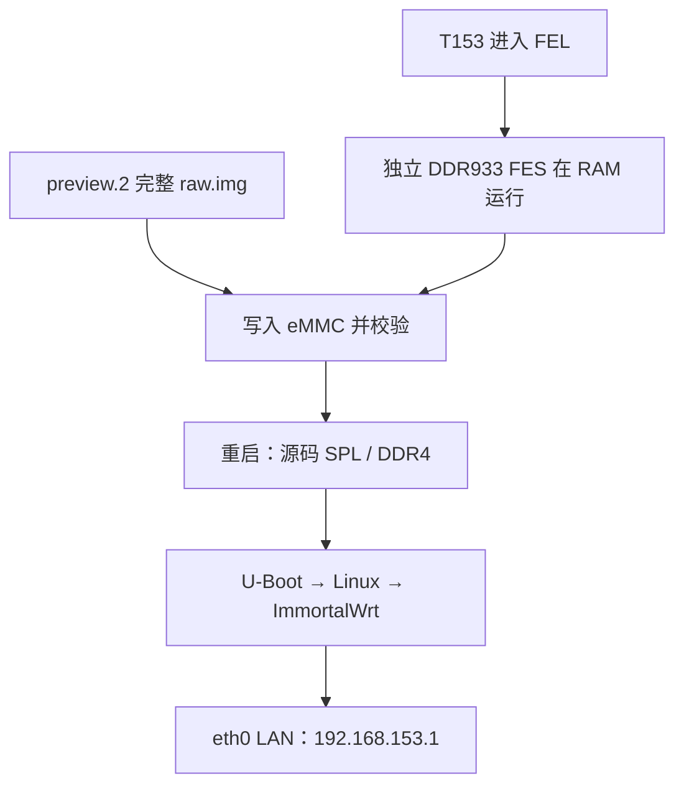

# OmniGate T153 · ImmortalWrt 25.12.2 preview.2

本版重新构建 T153 的源码 SPL/U-Boot，并重新打包 ImmortalWrt 完整 eMMC 镜像。保留 Argon 中文界面、4G 管理、mwan3、SmartDNS、DDNS 和流量统计。新增**未压缩 `.img`** 下载，Windows 可直接选中烧录。

[下载 preview.2](https://github.com/dshanpi/OmniGateT153-Openwrt25/releases/tag/v25.12.2-t153-immortalwrt-preview.2) · [软件功能与编译流程](IMMORTALWRT.md)

> 新版仍是预览版。此前“校验主线 SPL 失败”的实际原因尚未确定；重新生成镜像不能证明该问题已修复。本版的烧录、启动和长期稳定性须以本版镜像的实测结果为准。

## 下载哪两个文件

| 文件 | 在烧录工具中的用途 |
|---|---|
| [`immortalwrt-sunxi-cortexa7-dshanpi_t153mx-omnigate-ext4-raw.img`](https://github.com/dshanpi/OmniGateT153-Openwrt25/releases/download/v25.12.2-t153-immortalwrt-preview.2/immortalwrt-sunxi-cortexa7-dshanpi_t153mx-omnigate-ext4-raw.img) | **固件 / 完整 raw 镜像**，直接选择，无需解压 |
| [`t153-fes-ddr933-ram-loader.img`](https://github.com/dshanpi/OmniGateT153-Openwrt25/releases/download/v25.12.2-t153-immortalwrt-preview.2/t153-fes-ddr933-ram-loader.img) | **FES / loader 引导文件**，临时在 RAM 中运行 |
| [`SHA256SUMS`](https://github.com/dshanpi/OmniGateT153-Openwrt25/releases/download/v25.12.2-t153-immortalwrt-preview.2/SHA256SUMS) | 本版附件校验摘要 |

也提供同名 `.img.gz` 压缩下载；解压后与直接下载的 `.img` 是同一个完整盘。**不要把 `.img.gz`、FES、rootfs 或 FIT 当作完整 raw 镜像。** FES 不拼入 raw，不单独作为固件写入 eMMC。

本次交付的 Windows 文件放在 `G:\codex\t153\固件` 目录。以该目录内 `SHA256SUMS` 和说明文件为准，勿混入 preview.1 的 raw。

## 烧录

1. 备份需要保留的板上配置。完整盘烧录会覆盖 eMMC 分区表和镜像范围。
2. 按住 FEL 键接电或复位，让板卡进入 FEL，再连接 USB 数据口。扫描应识别到目标 T153，USB `1f3a:efe8`、SoC `0x1922`。
3. 在匹配本项目 loader 的 LYNX/OpenixCLI 中选择 **raw 完整镜像**流程，目标为 eMMC；固件选本版未压缩 `.img`，FES 选独立 DDR933 loader。
4. 启用写入校验与烧录后重启。串口被占用时先关闭其它串口终端；UART0 使用 3.3 V TTL、115200、8N1、无流控。
5. 点击烧录，等待写入、校验、重启均成功；进度到 100% 不能单独作为成功依据。若仍在 SPL 预检阶段失败，不等同于完成写入。
6. 重启后查看串口启动输出，再从 eth0/LAN 登录 LuCI。



保留 loader 原有 **+40960 扇区**映射，由匹配的 raw 后端补偿；不要替换为 `physical0` loader，不要手动重复修正扇区偏移。完整镜像不支持通过 LuCI“刷写固件”或 `sysupgrade` 升级。

## Windows 校验

在镜像所在目录打开 PowerShell：

```powershell
Get-FileHash '.\immortalwrt-sunxi-cortexa7-dshanpi_t153mx-omnigate-ext4-raw.img' -Algorithm SHA256
Get-FileHash '.\t153-fes-ddr933-ram-loader.img' -Algorithm SHA256
```

将结果与同目录 `SHA256SUMS` 对照。FES 保持原文件，固定大小 **1,154,048 字节**，SHA256：

```text
0d32d52139bc969f7f90665d32203ff07366ed0a31139bda607d89edbcd12873
```

## 首次访问

- **eth0 = LAN**，管理地址 [http://192.168.153.1/](http://192.168.153.1/)。电脑网线直连 LAN，自动获取 `192.168.153.x` 地址，首次使用 `root` 登录后设置密码。
- **eth1 = WAN**，默认 DHCP，不允许从 WAN 访问 LuCI。
- VMware VMnet8 若也使用 `192.168.153.1/24`，会与板卡冲突。将虚拟网卡改到其它网段，或在测试期间停用，再访问物理 LAN。
- mwan3、SmartDNS 预装但默认停用；4G 按实际模块端口与运营商 APN 配置。

## 版本与边界

系统基线为 ImmortalWrt **v25.12.2 / Linux 6.12.103**，硬件为 **T153 四核 Cortex-A7、1 GiB DDR4、eMMC**。板级 profile 为 `dshanpi_t153mx-omnigate`。U-Boot 包固定自身的构建版本字符串 `-OpenWrt-r33311-981c978eff` 和时间戳 `1792282260`，以重现既有 OpenWrt 引导链的构建条件；根文件系统仍为 ImmortalWrt。引导构建从源码完成，不依赖 Tina SDK 路径或预编译持久引导文件；临时 FES 和无线设备固件含二进制组件。

从源码构建时，使用 **preview.2 发布附件中的 `immortalwrt-25.12.2-t153-preview2.patch` 与原最小配置**，按[普通 feeds、menuconfig、make 流程](IMMORTALWRT.md#从官方源码构建)操作；不要混用 preview.1 的补丁摘要。新补丁摘要见 preview.2 的 `SHA256SUMS`。

在已解压的官方 `immortalwrt-25.12.2` 目录中执行：

```sh
patch -p1 < ../immortalwrt-25.12.2-t153-preview2.patch
./scripts/feeds update -a
./scripts/feeds install -a
make menuconfig
make download -j6
make -j6
```

选择 `sunxi → cortexa7 → DshanPI T153MX OmniGate`。不要先打 preview.1 补丁再叠加本补丁；preview.2 本身就是完整板级补丁。可继续使用原来的 `t153mx-omnigate-immortalwrt-v25.12.2.config` 最小配置。


目前 Linux 可见内存仍为 **384 MiB**；WAN 千兆稳定性问题未确认解决；Wi-Fi/蓝牙传输、EC20/ML302 拨号、多 WAN 切换及长期运行仍需实测。旧 OpenWrt 引导链曾通过板测，不等于这份 ImmortalWrt 镜像已经通过板测。

## preview.2 补丁验证

从官方 v25.12.2 源码归档重新解包后应用新补丁，全部 83 个变更文件与构建源码一致；上游系统版本、系统构建时间戳及 feeds 文件保持不变。补丁 SHA256：

```text
ea3aa43db99dcc2c6f947441a74b0711f5a6609220da43af1dd3f05344b60817
```
