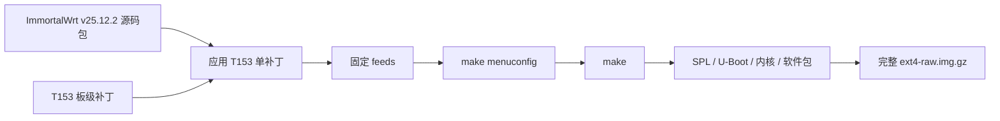
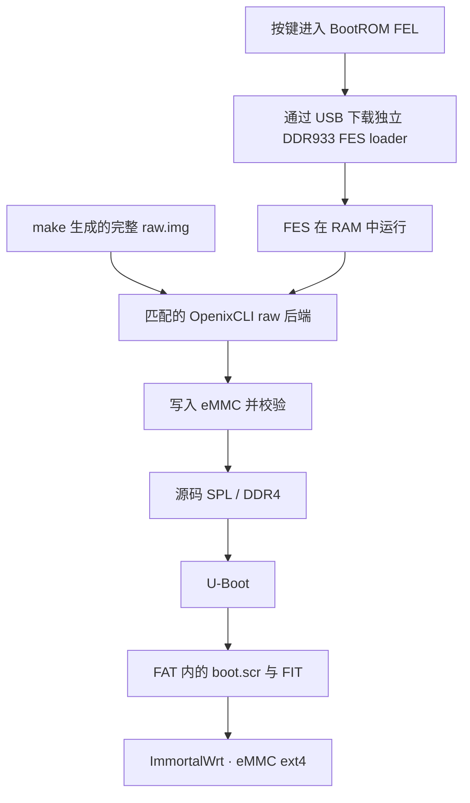

# OmniGate T153 · ImmortalWrt 25.12

为 T153MX OmniGate 提供 **ImmortalWrt 25.12.2、Argon 中文界面、4G 管理、多 WAN 和常用网络插件**。板级支持沿用本项目的源码 DDR4 初始化、SPL/U-Boot、四核启动、设备树及完整 eMMC 镜像构建流程。

> **软件验证预览版，2026-11-16。** 已完成完整编译和镜像结构、67 个必选包、HTTPS 后端及 AIC 模块/固件检查。**本版未烧录、未做硬件验收**；旧 OpenWrt 镜像的实测结果不能替代本版验收。

[下载镜像、独立 FES 与校验文件](https://github.com/dshanpi/OmniGateT153-Openwrt25/releases/tag/v25.12.2-t153-immortalwrt-preview.1)

项目：[dshanpi/OmniGateT153-Openwrt25](https://github.com/dshanpi/OmniGateT153-Openwrt25) · 上游：[ImmortalWrt](https://github.com/immortalwrt/immortalwrt/tree/v25.12.2)

## 版本与适用硬件

| 项目 | 本次基线 |
|---|---|
| 系统 | ImmortalWrt v25.12.2 |
| 上游源码提交 | `4fc16f2985a358bd43bb522e43f05395fcbd6ed5` |
| 内核 | Linux 6.12.103，加入本项目 T153 板级补丁 |
| 目标 | `sunxi/cortexa7` |
| 板卡 profile | `dshanpi_t153mx-omnigate` |
| 硬件配置 | T153，4× Cortex-A7，1 GiB DDR4，eMMC |
| 当前系统可见内存 | 384 MiB；不是完整使用 1 GiB |
| 持久引导 | 源码 DDR4/SPL + U-Boot 2026.07 |
| 包格式 | APK；不要混用旧 IPK 或其它内核版本的 kmod |
| 升级方式 | FEL + 独立 FES loader + 完整 raw 镜像 |

本项目提供板级移植补丁，尚不能称为 T153 已获 ImmortalWrt 官方支持。内核及 U-Boot 基于主线源码；外部 AIC 主机驱动、无线设备固件和临时 FES 引导的来源边界见下文。

## 默认功能

以下默认软件已固化在 T153 板卡 profile 中。正常执行 feeds 后，在 `make menuconfig` 选择 T153，即可带入 Argon 中文界面、4G 管理、多 WAN、SmartDNS、DDNS 和流量统计；无需另跑插件安装脚本。

| 功能 | 组成 | 使用方式 |
|---|---|---|
| 中文管理页面 | LuCI、Argon、Argon 配置、简体中文翻译 | 首次从 LAN 登录并设置管理员密码 |
| 4G 拨号 | QMI/MBIM/PPP、USB 网卡/串口驱动、LuCI 协议页面 | 按模块实际 USB 模式添加接口，填写运营商 APN |
| 4G 状态与短信 | 3ginfo-lite、sms-tool-js | 选对模块 AT 端口后使用 |
| 可选频段管理 | modemband，按需选装 | 仅对该工具明确支持的模块及固件启用 |
| 多 WAN | mwan3 与 LuCI 页面 | 用户配置出口、探测目标及策略后启用 |
| DNS | SmartDNS | 用户确认上游 DNS 和监听端口后接入 dnsmasq |
| 动态 DNS | DDNS 与 LuCI 页面 | 用户填写服务商账户及域名后启用 |
| 流量统计 | nlbwmon 与 LuCI 页面 | 用于查看内网设备流量 |
| 板载无线 | AIC8800D80 SDIO Wi-Fi、UART 蓝牙、BlueZ | 新镜像仍须分别验证 AP/客户端、配对与实际传输 |

固定 LuCI feed 中 Argon 为 **2.4.7-r20260824**，`luci-theme-argon` 与 `luci-app-argon-config` 是两个包；不要再叠加来自其它分支的 Argon 包。

配置采用保守默认值：**不自动拨号、不预填 APN 或模块端口、不自动启用多 WAN、不让 SmartDNS 默认接管 DNS**。短信设置使用 `prefix=0`，不擅自添加国家区号。联网认证信息和用户原有配置不放入发布镜像。

首次启动时，`t153-immortal-defaults` 仅对 `dshanpi,t153mx-omnigate` 板卡应用默认配置：设置 Argon 与中文、将 mwan3 的全部接口设为 `enabled=0` 并禁止服务自启、将 SmartDNS 设为 `enabled=0` 并禁止服务自启。完成后保存 `system.t153_immortal.applied=1` 标记；带此标记的配置恢复后不会被再次强制改回默认值；不含此标记的旧备份仍会触发本版首次初始化。

AIC Wi-Fi 使用本项目的 **`kmod-aic8800-t153-sdio`**，保留既有 T153 适配；不要同时选择 ImmortalWrt 自带的通用 SDIO 驱动包。默认排除 `automount`、`autocore` 和 `luci-app-cpufreq`，也不加入 Docker、多个代理套件或其它高资源服务。这个取舍不代表当前内存窗口和 CPU 电源管理限制已解决。

`mwan3 2.12.0-r3` 仍使用 iptables/ipset，通过 `iptables-nft`/`ip6tables-nft` 与 firewall4 配合，并不是原生 nft 后端；依赖安装完成不代表多出口切换已经实机验证。

EC20、ML302 的驱动识别、拨号和管理是三个不同层次。不能因为串口出现就认定联网成功。固定版本的 modemband 没有 EC20/ML302 命名模板，`2c7c:0125` 模板标注为 EC25；默认套件不据此承诺 EC20/ML302 锁频支持，确需使用时再确认命令兼容性并选装。双模块的 `/dev/ttyUSB*` 编号可能变化，应先确认 USB 路径、设备身份和 AT 响应，再选择拨号及短信端口。

## 从官方源码构建

构建不依赖 Tina SDK。使用 Linux 主机和普通用户，在独立目录下载源码、应用本版补丁，随后执行正常的 feeds、menuconfig 和 make。



### 1. 准备环境

Ubuntu 24.04 示例：

```sh
sudo apt-get update
sudo apt-get install build-essential clang flex bison gawk gcc-multilib \
  g++-multilib gettext git libncurses-dev libssl-dev libelf-dev \
  python3 python3-dev python3-setuptools python3-pyelftools \
  rsync swig unzip zlib1g-dev file wget curl ca-certificates patch \
  xz-utils bzip2 zstd time pkg-config
```

源码目录不要嵌套在无关 Git 仓库中，以免构建版本信息取错父仓库历史。已有 OpenWrt 工程无需移动或覆盖。下载缓存可以复用，旧版本的 `build_dir` 和 `staging_dir` 不作为新版本构建输入。

### 2. 下载源码并打补丁

先从 [本版发布页](https://github.com/dshanpi/OmniGateT153-Openwrt25/releases/tag/v25.12.2-t153-immortalwrt-preview.1) 下载 `immortalwrt-25.12.2-t153.patch` 与 `SHA256SUMS`，核对摘要并放入工作目录。补丁 SHA256 为：

```text
d6f0b0a19dbf9b6c8569d223d6aacb63cf2c19cbfc357898f0caa30dc3ad9756
```

```sh
mkdir -p ~/immortalwrt25-t153
cd ~/immortalwrt25-t153
curl --fail --location --output immortalwrt-25.12.2.tar.gz \
  https://codeload.github.com/immortalwrt/immortalwrt/tar.gz/refs/tags/v25.12.2
printf '%s  %s\n' \
  1126f61d9d300d165221419f54fef847dda955c9cb80a817f4b71b7c2fa187eb \
  immortalwrt-25.12.2.tar.gz | sha256sum -c -
sha256sum -c SHA256SUMS --ignore-missing
tar -xzf immortalwrt-25.12.2.tar.gz
cd immortalwrt-25.12.2
patch -p1 < ../immortalwrt-25.12.2-t153.patch
```

补丁应完整应用且无 `.rej`。不要对 ImmortalWrt 直接套用旧 `openwrt-25.12.6-t153.patch` 或旧版 `apply-native.sh`；后者可能写入旧系统版本与时间戳。

### 3. 正常 feeds 与 menuconfig

```sh
./scripts/feeds update -a
./scripts/feeds install -a
make menuconfig
```

选择：

```text
Target System  → Allwinner ARM SoCs
Subtarget      → Allwinner A20/A3x/H3/R40（cortexa7）
Target Profile → DshanPI T153MX OmniGate four-core Cortex-A7 (experimental)
```

Subtarget 的菜单名称未列出 T153，`cortexa7` 仍是正确项。保留 ext4 根文件系统；U-Boot 由板卡 profile 的构建依赖选择，不作为 rootfs 中的应用软件安装。

选择本 profile 即可自动选中上述默认套件。随补丁提供的最小配置仅指定三个目标选项及简体中文：

```text
CONFIG_TARGET_sunxi=y
CONFIG_TARGET_sunxi_cortexa7=y
CONFIG_TARGET_sunxi_cortexa7_DEVICE_dshanpi_t153mx-omnigate=y
CONFIG_LUCI_LANG_zh_Hans=y
```

如需快速导入，可在 `make menuconfig` 前复制这份配置；之后仍能在菜单中按需增删包：

```sh
cp /path/to/t153mx-omnigate-immortalwrt-v25.12.2.config .config
make defconfig
make menuconfig
```

保留 v25.12.2 自带 `feeds.conf.default` 的固定提交：

| feed | 固定提交 |
|---|---|
| packages | `84bd86384928955b568988ca0e09e2c78c75173d` |
| luci | `d6167ea0645cbd1327708d85f94824f42d0eb872` |
| routing | `e49d76035aafb85ddc993b59271d8c7ba56b5362` |

不要把 feeds 改为浮动分支后继续使用本版“已验证配置”的标识。

### 4. 编译与检查

```sh
make defconfig
make download -j6
make -j6
```

根据主机资源调整并行数；发生构建错误后使用 `make -j1 V=s` 获取完整错误。无需额外运行外层镜像打包脚本。

完整盘输出为：

```text
bin/targets/sunxi/cortexa7/*-dshanpi_t153mx-omnigate-ext4-raw.img.gz
```

保存同目录的 `config.buildinfo`、`feeds.buildinfo`、`version.buildinfo`、manifest 和 `sha256sums`。在输出目录执行：

```sh
sha256sum -c sha256sums --ignore-missing
```

随项目提供的独立软件验证器检查启动区、FIT/内核/设备树、实际根文件系统、安装包及版本。它不访问板卡，不证明硬件已经通过验证：

```sh
python3 /path/to/verify-image.py \
  --source /path/to/immortalwrt-25.12.2 \
  --output /path/to/artifacts/immortalwrt-image-validation.json \
  --raw-output /path/to/artifacts/immortalwrt-t153-raw.img
```

输出目录应位于源码树外。验证器位于仓库 `tests/immortalwrt/verify-image.py`，与同目录 `required-packages.json` 配套使用。发布附件已包含构建记录、原始镜像字节数/SHA256、完整软件验证报告及验证脚本归档。

## 镜像与独立 FES 烧录



烧录需要两个独立文件：

| 文件 | 用途 |
|---|---|
| 解压后的本次 `ext4-raw.img` | 写入 eMMC 的完整盘，包含分区表、持久引导、内核和根文件系统 |
| `t153-fes-ddr933-ram-loader.img` | 仅在 RAM 中运行的临时烧录引导 |

固定 loader 为 **1,154,048 字节**，SHA256：

```text
0d32d52139bc969f7f90665d32203ff07366ed0a31139bda607d89edbcd12873
```

[本版发布页](https://github.com/dshanpi/OmniGateT153-Openwrt25/releases/tag/v25.12.2-t153-immortalwrt-preview.1) 已附带同一个已核对的 loader，必须校验上述摘要。使用本版 ImmortalWrt raw，不能把旧 OpenWrt raw 当作本版镜像。

### 本版下载与校验

| 附件 | 用途 |
|---|---|
| [完整镜像](https://github.com/dshanpi/OmniGateT153-Openwrt25/releases/download/v25.12.2-t153-immortalwrt-preview.1/immortalwrt-sunxi-cortexa7-dshanpi_t153mx-omnigate-ext4-raw.img.gz) | 解压后用于 FES 写入 eMMC |
| [独立 FES](https://github.com/dshanpi/OmniGateT153-Openwrt25/releases/download/v25.12.2-t153-immortalwrt-preview.1/t153-fes-ddr933-ram-loader.img) | 保持原文件，临时在 RAM 中运行 |
| [SHA256SUMS](https://github.com/dshanpi/OmniGateT153-Openwrt25/releases/download/v25.12.2-t153-immortalwrt-preview.1/SHA256SUMS) · [raw 摘要](https://github.com/dshanpi/OmniGateT153-Openwrt25/releases/download/v25.12.2-t153-immortalwrt-preview.1/RAW-SHA256.txt) | 分别核对下载附件及解压后的完整盘 |
| [板级补丁](https://github.com/dshanpi/OmniGateT153-Openwrt25/releases/download/v25.12.2-t153-immortalwrt-preview.1/immortalwrt-25.12.2-t153.patch) · [最小配置](https://github.com/dshanpi/OmniGateT153-Openwrt25/releases/download/v25.12.2-t153-immortalwrt-preview.1/t153mx-omnigate-immortalwrt-v25.12.2.config) | 从官方源码自行构建 |
| [离线 APK 备份](https://github.com/dshanpi/OmniGateT153-Openwrt25/releases/download/v25.12.2-t153-immortalwrt-preview.1/immortalwrt-25.12.2-t153-apk-packages.tar.gz) | 仅含本镜像实际安装的 277 个包，以及签名公钥 |

压缩镜像为 **20515187 字节**，解压 raw 为 **306184192 字节（292 MiB）**。raw SHA256：

```text
4696ba063dba1fd148ef132cec07c1895c406426e1b553181a33c38b2819df21
```

离线 APK 仅对应本版内核和包签名。其它固件的 kmod 即使同为 6.12，也不能强制混装；完整系统升级仍使用 raw/FES 流程。归档不包含签名私钥。

### 操作顺序

1. 备份配置和数据。完整盘烧录会覆盖 eMMC 分区表及镜像范围；移除可能带有相同 PARTUUID 的 SD 卡。
2. 将目标板进入 FEL，通过 USB 数据口连接烧录主机。扫描确认 T153：USB `1f3a:efe8`，SoC `0x1922`。未进入 FEL 时不启动烧录。
3. 校验 loader 与镜像摘要，将 `raw.img.gz` 解压为完整 `raw.img`。记录 raw 的实际大小和 SHA256。FES 输入不能选 gzip 文件、rootfs、FIT 或 initramfs。
4. 在支持该 loader 的 LYNX/OpenixCLI raw 流程中选择完整 raw 和独立 loader，启用写入校验与烧录后重启。预检需要串口独占时，先关闭其它串口终端。
5. 等待同一任务完成。必须同时得到 `state=success`、`exitCode=0`、`verifyState=success`、`postFlashState=success`，且 `writtenBytes=committedBytes=实际 raw 字节数`。进度 100% 不等于写入校验成功。
6. 保存完整任务状态和 UART0 启动日志，继续进行系统验收。串口采用 3.3 V TTL、115200、8N1、无流控。

现有 LYNX MCP 操作示例：

```json
{
  "firmwarePath": "<烧录主机上的本次完整 raw.img 绝对路径>",
  "confirmDestructive": true,
  "options": {
    "mode": "command",
    "verify": true,
    "postFlashAction": "reboot",
    "vendorOptions": {
      "raw": true,
      "loaderPath": "<烧录主机上的 t153-fes-ddr933-ram-loader.img 绝对路径>"
    }
  }
}
```

上述对象是 `lynx_start_flash` 的 arguments，**不是 shell 命令**。以当前 LYNX 工具 schema 为准；完整连接、下载、任务轮询示例见项目的 `host-tools/README.txt` 和 `host-tools/mcp-fes-workflow.example.json`。

保留 loader 原有 **+40960 扇区**映射，由匹配的 OpenixCLI raw 后端补偿。不要使用 `physical0` loader，不要重复修正偏移，不要替换成旧 1066 MHz loader 或 `-smp-fel.bin`。历史上的 `0xffffxxxx` 扇区越界与双重抵消有关，见 `docs/FES-RAW-MAPPING-CORRECTION.txt`。

**FES 不拼入 raw，也不单独写入 eMMC。** 临时 FES/DDR/U-Boot 含厂商二进制；持久启动的源码 DDR/SPL/U-Boot 是另一条链。AIC 无线设备固件同样含二进制，不能把整套系统描述为“全部没有二进制组件”。

镜像默认 FAT 启动分区为 32 MiB，根分区为 256 MiB，总计 292 MiB；用户调整根分区后应重新计算大小。独立 U-Boot 整盘读回必须在首次 Linux 写根分区前进行，并按实际镜像大小核对 RAM 空间与读回范围；不要直接套用其它镜像的扇区数或摘要。

本板尚不支持通过 `sysupgrade` 或 LuCI“刷写固件”升级。本版仍使用上述完整盘 FES 流程；`sysupgrade -r` 仅用于配置恢复，不是固件更新。跨发行版不要直接恢复全部旧配置。

## 首次访问与插件配置

**eth0 是 LAN，eth1 是 WAN。** 默认 LAN 地址为 `192.168.153.1/24`；WAN 为 DHCP 客户端，默认不允许从 WAN 访问 LuCI。

1. 电脑网线直连板上 eth0/LAN，网卡设置为自动获取 IPv4。
2. 检查电脑得到 `192.168.153.x` 地址、网关为 `192.168.153.1`。
3. 浏览器访问 [http://192.168.153.1/](http://192.168.153.1/)，首次登录后设置管理员密码。
4. 如需手动测试，可给直连网卡设置 `192.168.153.2/24`；不要给电脑设置 `192.168.153.1`。

页面打不开时，先检查电脑的地址和路由。特别是 **VMware VMnet8 可能已占用 `192.168.153.1/24`**：此时浏览器可能访问电脑自身或走向虚拟网卡。将 VMnet8 的 NAT 子网改到不重叠的网段，或在测试期间停用该虚拟网卡，再确认物理 LAN 网卡地址。不要为解决地址冲突而开放 WAN 防火墙。

若电脑只有 `192.168.1.x` 地址，通常还在上级路由器的网段，不能据此认定已连到板子的 LAN。再检查网口接线、链路、DHCP 和 VPN/代理对内网访问的影响。

常用菜单入口：

| 功能 | LuCI 菜单 |
|---|---|
| Argon | 系统 → Argon 主题设置 |
| 4G 状态 | 模块 → 3G/4G/5G 连接信息 |
| 短信 | 模块 → 短信 |
| 多 WAN 配置 | 网络 → MultiWAN 管理器 |
| 多 WAN 状态 | 状态 → MultiWAN 管理器 |
| DNS | 服务 → SmartDNS |
| DDNS | 服务 → 动态 DNS |
| 流量统计 | 服务 → 带宽监控 |

插件配置建议按顺序完成：先验证单路有线网络，再单独验证每个 4G 模块能拨号、解析 DNS 和传输；随后配置 mwan3 的出口、接口启用状态、探测目标与切换策略，再启动服务并启用开机自启。SmartDNS 应在确认上游 DNS、dnsmasq 与自身监听端口不冲突后，将配置中的启用选项打开，再启动服务并启用开机自启。首次启动默认禁用这两个服务，仅安装插件或填写配置不会自动激活它们。保存设置前核对界面，不要直接填入其它板子的 AT 端口或 APN。

## 本版验收与已知限制

软件验证通过后，硬件验证仍需绑定**本次镜像 SHA256**记录。以下命令用于采集基础信息，不表示这些结果已经取得：

```sh
cat /etc/openwrt_release
uname -r
ubus call system board
cat /sys/devices/system/cpu/online
grep -c '^processor' /proc/cpuinfo
cat /proc/mounts
free -m
ip -br addr
ethtool eth0
ethtool eth1
```

| 验收项目 | 本版应保存的证据 |
|---|---|
| 软件构建 | 源码与补丁 SHA、feeds、完整配置、退出码、日志 |
| 镜像结构 | 引导/FIT/DTB/根分区检查、软件包清单、只读 fsck、验证报告 |
| FES 写入 | loader SHA、最终任务状态、raw 字节数及写入校验 |
| 启动与存储 | 完整串口日志、实际系统版本、eMMC ext4 可写状态 |
| 四核 | CPU `0-3` 在线、固定核心并发任务与结果 |
| LuCI | 物理 LAN 浏览器登录、Argon 与简体中文、插件菜单 |
| 网络 | LAN/WAN 持续吞吐、协商速率与掉线计数 |
| 4G 与多 WAN | EC20/ML302 分别拨号、重连、断网切换与恢复 |
| 无线与蓝牙 | Wi-Fi 客户端/AP 传输、蓝牙配对与传输 |
| 稳定性 | 物理冷启动、多次重启、长时间 CPU/DDR/存储/网络压力 |

目前须保留以下限制：

- Linux/U-Boot 可见内存沿用 384 MiB 窗口，尚未开放物理 1 GiB 的全部空间。
- CPU_OFF/hotplug、suspend、多核 kexec 尚不在已实现接口范围内。
- WAN 千兆反复协商或降速的问题尚未证明解决；更换为 ImmortalWrt 不等于驱动问题自然消失。用户已确认同板、同线、同对端、同 EC20 在原厂 Tina 下稳定，不应未经证据归咎于线材或模块。
- 本版 Wi-Fi/蓝牙、EC20/ML302 数据拨号和 mwan3 切换均须重新验证。
- 本版软件回 FEL、物理断电冷启动和长期负载稳定性未完成验收前，不写成已通过。

发布时应将“构建完成”“软件镜像检查通过”“FES 写入通过”“硬件启动通过”“长期稳定通过”分别记录，并保留未测项。

## 本版软件验收记录

| 检查项 | 结果 |
|---|---|
| 官方源码归档 + 单补丁 | 干净归档测试通过，83 个变更文件一致 |
| 常规 feeds / defconfig / make | 编译退出码 0，固定 feeds 提交未改动 |
| SPL/U-Boot、磁盘分区、FIT 与设备树 | 通过；四个 CPU 节点、384 MiB Linux 内存窗口 |
| 内核与根文件系统 | Linux 6.12.103；普通持久根文件系统启动，非完整 initramfs 系统 |
| 包和 HTTPS 后端 | 67 个必选包的配置、manifest、镜像数据库一致；仅 OpenSSL ustream 后端 |
| AIC8800D80 | 两个 ARM 模块均匹配 6.12.103 SMP，15 个固件文件摘要通过 |
| 发布内容 | root 初始无密码；未放入设备私钥、旧板网络配置或构建签名私钥 |
| 烧录与硬件 | **本版未执行**；无线、4G 数据通路、多 WAN 切换及长期稳定性待验收 |

初次整编曾发现两个 SSL 后端同时入选，发布前已统一为 `luci-ssl-openssl`，清除旧 `luci-ssl`、mbedTLS ustream 和 px5g 依赖并重新编译验证。Wi-Fi 使用的 `wpad-basic-mbedtls` 与 `libmbedtls` 保留，二者用途不同。

板上可运行仓库的 `tests/immortalwrt/runtime-check.sh` 获取只读验收快照。脚本不拨号、不改路由、不重启，不代替 LAN/WAN 外部访问、Wi-Fi/蓝牙传输和真实多 WAN 断线恢复测试。
